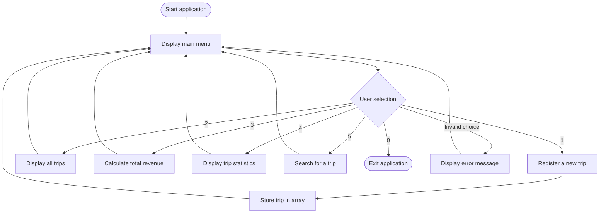

---
aliases:
  - Java Fundamentals Capstone
  - Trip Management System
tags:
  - java
  - programming
  - capstone
  - fundamentals
title: Java Fundamentals Capstone --- Trip Cost & Fare Management System
---
# Java Fundamentals Capstone Project

## Trip Cost & Fare Management System

**Level:** Beginner to intermediate **Format:** Console application **Dependencies:** Standard Java Development Kit (JDK) only **Storage:** In-memory arrays; no database or external libraries

## Project objective

Build a small, realistic Java application that simulates a transport company's trip-management system. Users should be able to register journeys, calculate durations and fares, review trip records, search for trips, and generate basic business statistics.

The objective is not merely to make a program that runs. You should demonstrate that you understand how Java's fundamental language features work, why they behave as they do, and how they interact in a small object-oriented program.

### Concepts covered by this project

- Basic Java syntax and program lifecycle
- Primitive and reference data types
- Variables, constants, and scope
- Type casting
- Strings and String methods
- Mathematical operations
- Arrays
- Conditional statements
- Loops
- Classes, objects, fields, methods, and constructors

### Scope restrictions

For this project, deliberately avoid:

- `ArrayList` and other collection classes
- Inheritance and interfaces
- Streams and lambdas
- Databases and file persistence
- Frameworks and external libraries
- Advanced exception-handling frameworks

Use a regular array of `Trip` objects. The purpose is to master the concepts in the current roadmap before moving on.

---

# 1. Real-world scenario

Imagine that you are developing a small application for a transport company. The company wants to keep track of customer journeys and calculate how much each journey costs.

Each trip has the following information:

|Attribute|Description|Example|
|---|---|---|
|Trip ID|Unique trip identifier|`1001`|
|Customer name|Person requesting transport|`Alex`|
|Starting point|Where the journey begins|`Kigali`|
|Destination|Where the journey ends|`Musanze`|
|Distance|Journey distance in kilometres|`100.5`|
|Average speed|Vehicle speed in km/h|`60`|
|Price per kilometre|Company's rate|`350 RWF`|

The application should calculate:

1. Journey duration.
2. Estimated fare.
3. Trip classification.
4. Total revenue.
5. Average trip distance.
6. Longest and shortest journeys.

The application should support multiple trips during one execution.

---

# 2. Application architecture

Separate the application into three classes, each with a clear responsibility.

## `Main.java`

Responsible for:

- The `main()` entry point.
- Displaying the menu.
- Receiving user input.
- Calling the appropriate `TripManager` methods.
- Keeping the application running until the user exits.

## `Trip.java`

Represents one individual journey. Responsible for:

- Holding the data for one trip.
- Initializing trip data through a constructor.
- Calculating journey duration.
- Calculating the fare.
- Determining trip classification.
- Displaying trip information.

## `TripManager.java`

Responsible for managing multiple trip objects. It should:

- Store up to 10 `Trip` objects in an array.
- Track how many trips have actually been registered.
- Register new trips.
- Display all registered trips.
- Calculate total revenue.
- Generate trip statistics.
- Search for a trip by ID.

## Application flow



---

# 3. Functional requirements

## Feature 1 — Main menu

When the program starts, display a menu similar to this:

```text
====================================
       TRIP MANAGEMENT SYSTEM
====================================

1. Register a new trip
2. View all trips
3. Calculate total revenue
4. View trip statistics
5. Search trip by ID
6. Exit

Enter your choice:
```

Requirements:

- The menu must continue appearing until the user chooses `0`.
- The application must respond to invalid menu selections.
- Each menu selection must execute the appropriate operation.
- The program should terminate cleanly when the user exits.

**Concepts tested:** basic syntax, `main()` and program execution, variables and scope, `Scanner`, conditional statements, and loops.

## Feature 2 — Register a trip

Ask the user to enter:

```text
Customer name:
Starting location:
Destination:
Distance (km):
Average speed (km/h):
Price per kilometre:
```

Example input:

```text
Customer name: Alex
Starting location: Kigali
Destination: Musanze
Distance: 100.5
Average speed: 60
Price per kilometre: 350
```

Requirements:

- Store customer names and locations as `String` values.
- Choose appropriate numeric types for distance, speed, and price.
- Distance, speed, and price must be greater than zero.
- Every trip must have a unique ID.
- Do not register a trip if the storage capacity has been reached.
- Remove unnecessary leading and trailing whitespace from text input.

**Concepts tested:** primitive versus reference types, variable declarations, constants, scope, type casting, String handling, constructors and objects, arrays, and conditionals.

## Feature 3 — Calculate journey duration and fare

Duration formula:

$$ \text{Duration (minutes)} = \frac{\text{Distance (km)}}{\text{Speed (km/h)}} \times 60 $$

Fare formula:

$$ \text{Fare} = \text{Distance} \times \text{Price per kilometre} $$

For the example trip:

- Distance: `100.5 km`
- Speed: `60 km/h`
- Rate: `350 RWF/km`

Expected calculations:

$$ \text{Duration} = 100.5 \text{ minutes} $$

$$ \text{Fare} = 35{,}175 \text{ RWF} $$

Requirements:

- Store duration using an appropriate numeric type.
- Display duration in minutes.
- Display fare to two decimal places.
- Do not accidentally perform integer division.
- Understand when and why explicit type casting is necessary.

**Concepts tested:** arithmetic operators, operator precedence, integer versus floating-point division, type casting, ternary operators (optional), and `String.format()`.

## Feature 4 — Classify trips

Apply these business rules:

|Distance|Classification|
|---|---|
|Below 10 km|Short trip|
|10 km through 50 km, inclusive|Medium trip|
|Above 50 km|Long trip|

Requirements:

- Classify every registered trip.
- Display the classification when viewing trip information.
- Correctly handle boundary values such as exactly `10 km` and `50 km`.

**Concepts tested:** `if`, `else if`, `else`, relational operators, logical operators, and method return values.

## Feature 5 — View all trips

Display all registered trips in a readable format.

Example:

```text
============== REGISTERED TRIPS ==============

ID: 1001
Customer: Alex
Route: Kigali -> Musanze
Distance: 100.50 km
Duration: 100.50 minutes
Fare: 35175.00 RWF
Classification: Long trip

-----------------------------------------------

ID: 1002
Customer: David
Route: Kigali -> Muhanga
Distance: 55.00 km
Duration: 55.00 minutes
Fare: 19250.00 RWF
Classification: Long trip
```

Requirements:

- Iterate through the trip array.
- Display every registered trip.
- Do not display unused array positions.
- Handle the situation where no trips have been registered.

**Concepts tested:** arrays, array indexes, array length, `for` and `while` loops, object references, and methods.

## Feature 6 — Calculate total revenue

Calculate the combined fare of all registered trips:

$$ \text{Total Revenue} = \sum_{i=1}^{n} \text{Trip Fare}_i $$

Requirements:

- Iterate over the array.
- Accumulate each trip's fare.
- Return the final result.
- Handle an empty array correctly.

**Concepts tested:** loops, accumulator variables, arithmetic operations, methods, return types, and variable scope.

## Feature 7 — Generate trip statistics

Generate the following statistics:

1. Number of registered trips.
2. Total distance travelled.
3. Average distance per trip.
4. Longest trip.
5. Shortest trip.
6. Total revenue.

Example input distances:

```text
Trip 1: 100 km
Trip 2: 50 km
Trip 3: 25 km
```

Expected results:

|Statistic|Expected result|
|---|---|
|Number of trips|3|
|Total distance|175 km|
|Average distance|58.33 km|
|Longest trip|100 km|
|Shortest trip|25 km|

This feature combines arrays and objects. You must traverse the array, access each trip's data, and maintain the appropriate running totals and comparisons.

## Feature 8 — Search for a trip

Allow the user to enter a trip ID.

Requirements:

- Search the registered trips.
- Display the matching trip.
- Inform the user if no matching trip exists.

**Concepts tested:** array traversal, comparisons, conditionals, and object references.

---

# 4. Technical implementation requirements

These requirements describe how the classes should be structured. They are not complete code solutions.

## Class 1 — `Trip`

Create a class named `Trip`. It represents one individual customer journey.

Suggested fields:

|Field|Suggested type|
|---|---|
|`tripId`|`int`|
|`customerName`|`String`|
|`origin`|`String`|
|`destination`|`String`|
|`distanceInKm`|`double`|
|`averageSpeed`|`double`|
|`pricePerKm`|`double`|

Your class must have:

1. A constructor that initializes a trip.
2. A method that calculates journey duration.
3. A method that calculates the fare.
4. A method that determines the trip classification.
5. A method that displays the trip's information.

Think carefully about which methods should return values and which should simply perform an action.

For example, a method calculating a fare should return a numeric value rather than print it directly. This allows other classes to use that calculation.

## Class 2 — `TripManager`

This class manages multiple trip objects.

It should contain:

- An array capable of storing 10 `Trip` objects.
- A variable tracking how many trips have been registered.
- A method to register a trip.
- A method to display all trips.
- A method to calculate total revenue.
- A method to generate statistics.
- A method to search for a trip by ID.

**Important:** Your array should be an array of objects:

```java
Trip[] trips;
```

You are now storing references to objects that contain their own data and behaviour, rather than storing only primitive values.

## Class 3 — `Main`

This is where the application begins.

It should:

- Contain the `main()` method.
- Create the necessary objects.
- Display the application menu.
- Receive user input.
- Call the appropriate `TripManager` methods.
- Keep the application running until the user exits.

Avoid putting all calculations and business logic inside `main()`.

The purpose of separating these classes is to understand how different objects collaborate.

---

# 5. Learning milestones

Do not attempt to implement everything simultaneously. Complete each milestone and test it before proceeding.

## Milestone 1 — Build the foundation

Create the project and establish the three Java classes.

Implement:

- Basic class declarations.
- The `main()` method.
- Variable declarations.
- Primitive and reference data types.
- Constants.
- Constructors.

**Completion test:** Instantiate a `Trip` object and display its information.

**Concepts:** syntax, lifecycle, data types, variables, and basic OOP.

## Milestone 2 — Implement the calculations

Implement duration, fare, and trip classification.

Pay particular attention to:

- Integer versus floating-point arithmetic.
- Explicit and implicit casting.
- Mathematical operator precedence.
- Returning values from methods.
- String formatting.

**Completion test:** Given a trip's inputs, your methods produce the expected calculations.

**Concepts:** mathematics, casting, Strings, and methods.

## Milestone 3 — Introduce arrays

Implement the `TripManager` class.

Create an array of 10 trip references and manage its occupied positions.

Understand:

- Array initialization.
- Array indexes.
- Array length.
- The difference between array capacity and the number of registered trips.
- What happens when an array position contains `null`.

**Completion test:** Register five different trips and display all five without displaying unused positions.

**Concepts:** arrays and reference types.

## Milestone 4 — Implement control flow

Implement the interactive menu.

Use:

- A `while` or `do-while` loop.
- A `switch` statement or `if-else` statements.
- `for` loops for array traversal.
- Conditional expressions for validation.

**Completion test:** The menu continues working after multiple operations and exits only when requested.

**Concepts:** conditionals and loops.

## Milestone 5 — Implement statistics and searching

Implement revenue calculations, distance statistics, and trip lookup.

**Completion test:** Your application produces correct results when there are zero, one, and several registered trips.

## Milestone 6 — Integration and quality assurance

Test the entire application against the test cases in the next section.

Refactor duplicated code, improve method names, and ensure that each class has a clear responsibility.

**Completion test:** All required test cases pass, and you can explain the implementation without relying on memorized code.

---

# 6. Mandatory testing scenarios

These tests are designed to expose misunderstandings that might otherwise remain hidden.

## Test A — Mathematical precision

Register a trip with:

|Input|Value|
|---|---|
|Distance|10 km|
|Speed|3 km/h|
|Rate|100 RWF/km|

Expected:

$$ \text{Duration} = 200 \text{ minutes} $$

$$ \text{Fare} = 1000 \text{ RWF} $$

**Knowledge checkpoint:** Why would an implementation that uses integer division produce an incorrect duration?

## Test B — Conditional boundaries

Test these distances:

|Distance|Expected classification|
|---|---|
|9.99 km|Short|
|10 km|Medium|
|10.01 km|Medium|
|50 km|Medium|
|50.01 km|Long|

**Knowledge checkpoint:** How would you write your conditions to ensure that no boundary is accidentally excluded?

## Test C — Empty arrays

Start the application and immediately request:

- All trips.
- Total revenue.
- Trip statistics.
- Trip search.

**Expected:** The program handles all four requests without crashing or producing misleading results.

**Knowledge checkpoint:** Why must you avoid dividing by zero when calculating average distance?

## Test D — Array capacity

Register 10 trips and attempt to register an 11th.

**Expected:** The application refuses the additional registration and informs the user that storage is full.

**Knowledge checkpoint:** Why is the array's `length` not necessarily equal to the number of registered trips?

## Test E — Object references

Create two trips with different data.

Verify that initializing one trip does not accidentally change the other.

**Knowledge checkpoint:** What exactly is stored inside a `Trip[]` array: the complete objects or references to those objects?

## Test F — String manipulation

Try customer names and locations such as:

```text
"  Alex  "
"alex"
"ALEX"
"  Kigali  "
```

Your application should trim unnecessary leading and trailing whitespace.

**Knowledge checkpoint:** What is the difference between `equals()` and `==` when comparing Java Strings?

## Test G — Scope

Declare a variable inside a method and attempt to access it from another method.

Explain why this is not permitted.

**Knowledge checkpoint:** What is the difference between a local variable, an instance variable, and a class-level `static` variable?

---

# 7. Expected project structure

Your final source directory should look like this:

```text
TripManagementSystem/
│
└── src/
    ├── Main.java
    ├── Trip.java
    └── TripManager.java
```

Compile and execute it from your Fedora terminal:

```bash
javac -d out src/*.java
java -cp out Main
```

No Maven or Gradle is necessary. Use the standard JDK.

---

# 8. Expert-level knowledge checkpoint

After completing the project, you should be able to answer these questions without searching for answers.

|Topic|Question|
|---|---|
|Program lifecycle|What happens when the JVM executes your `main()` method?|
|Data types|Why can an `int` store a whole number but not a decimal fraction?|
|Reference types|What is the difference between a primitive variable and an object reference?|
|Scope|Why can't a local variable be accessed outside its declaring method?|
|Casting|What happens when you convert a `double` to an `int`?|
|Strings|Why are Strings immutable in Java?|
|Methods|What is the difference between a method's return type and its parameters?|
|Math|Why does integer division discard the fractional part?|
|Arrays|Why does Java use zero-based array indexing?|
|Conditionals|How does Java evaluate chained `if-else` conditions?|
|Loops|When would you choose `while` over `for`?|
|OOP|What is the difference between a class and an object?|
|Constructors|Why do we use constructors when creating objects?|
|Encapsulation|Why should fields generally not be directly accessible from other classes?|

Some questions, particularly encapsulation and `static`, go slightly beyond the minimum implementation requirements. Treat them as conceptual challenges rather than reasons to introduce advanced features into the project.

---

# 9. Assessment rubric

**Total: 100 points**

|Assessment area|Points|
|---|---|
|Basic syntax and program lifecycle|10|
|Data types, variables, and casting|10|
|Strings, methods, and mathematical operations|15|
|Arrays and object references|15|
|Conditionals and loops|15|
|Object-oriented design|20|
|Testing, correctness, and code quality|15|
|**Total**|**100**|

Suggested interpretation:

|Score|Assessment|
|---|---|
|90–100|Strong mastery|
|80–89|Good understanding|
|70–79|Developing proficiency|
|Below 70|Revisit weak concepts|

A passing score alone is not sufficient. You must also explain your implementation and pass the mandatory edge-case tests.

---

# 10. Rules for completing this capstone

1. **Do not copy an existing solution.** Write the implementation yourself.
2. Do not ask for all three classes to be generated for you. That would defeat the purpose.
3. You may consult Java documentation when you do not understand a method or language feature.
4. If something does not work, investigate the error before changing random sections of code.
5. Be prepared to explain every variable, method, condition, loop, and object.
6. Do not introduce concepts from later roadmap sections just to make the application more sophisticated.

## First assignment — Milestone 1

Your first task is to:

1. Create the three files: `Main.java`, `Trip.java`, and `TripManager.java`.
2. Establish the three class declarations.
3. Implement the `Trip` constructor.
4. Instantiate a `Trip` object in `Main`.
5. Display that trip's information.

When you finish, share your three source files for review.

The review will examine:

- Whether your syntax is correct.
- Whether you understand your data types.
- Whether your constructor is properly designed.
- Whether your objects are initialized correctly.
- Whether you can explain the decisions behind your implementation.

We will only move to **Milestone 2** once you have demonstrated that you understand Milestone 1.

---

## Definition of done

You are ready to move beyond this roadmap's fundamentals when:

- [ ] All three classes have clear responsibilities.
- [ ] All eight application features work.
- [ ] All mandatory test scenarios pass.
- [ ] You can explain primitive and reference types.
- [ ] You can explain scope and type casting.
- [ ] You can explain String comparison and manipulation.
- [ ] You can traverse and manage an array of objects.
- [ ] You can explain the role of each constructor and method.
- [ ] You can explain how the three classes collaborate.
- [ ] You can implement the core functionality again without copying your previous solution.

**The goal:** Finish this project with a working application and a demonstrable understanding of Java fundamentals — not simply a completed programming exercise.